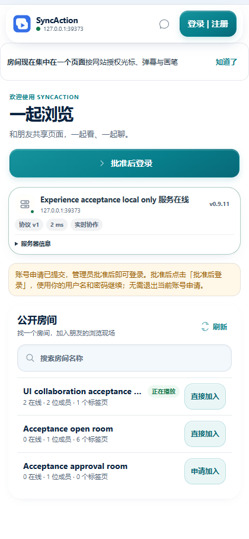
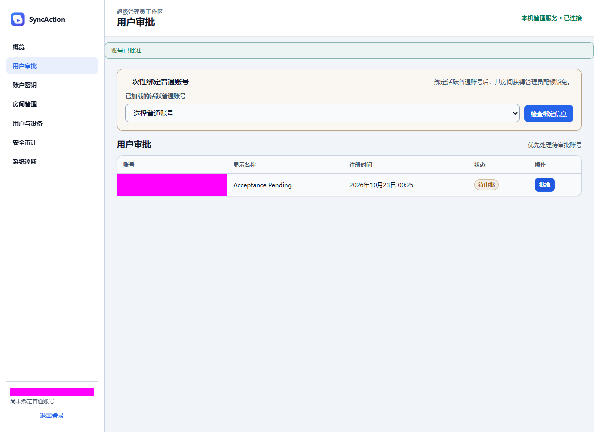
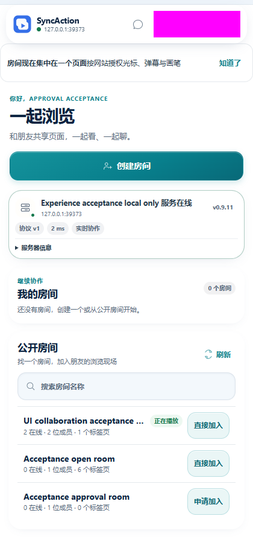
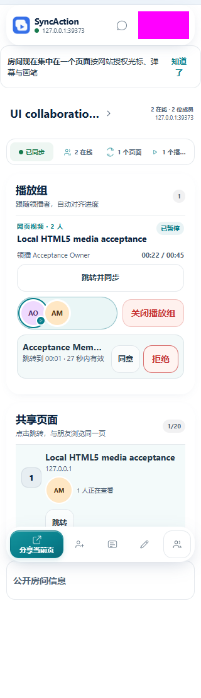
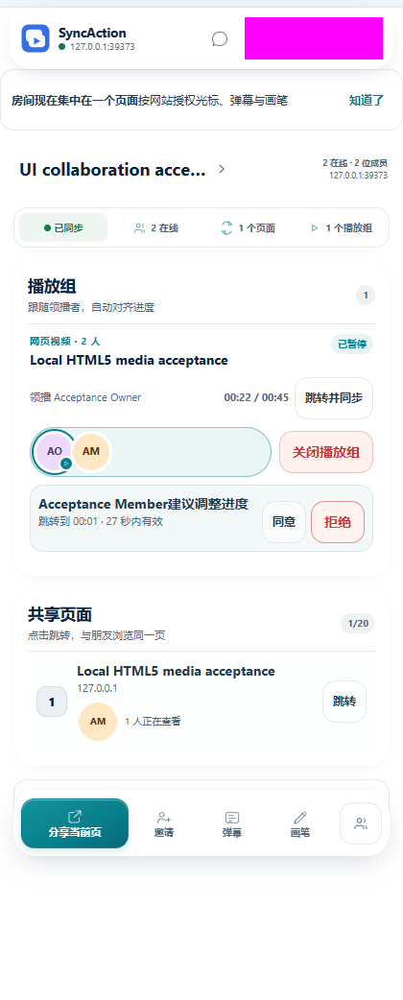

# 首次协作验收

日期：2026-10-23（Asia/Hong_Kong）。

## 基线

公开 v0.9.10 是脱敏重建历史，旧开发工作区与其没有共同祖先。本轮在公开主线基础上复用已有投影解耦提交，再按文件与行为整合首配、认证续接、媒体首组与状态读取；未覆盖或丢弃旧工作区的未提交成果。

公开源码不加入个人生产域名、运维配置或数据库。运行时默认占位配置与已验证测试服务器使用不同地址，避免把首次安装与已配置场景混为一谈。

## 功能验收出口

1. 占位配置直接进入服务器验证，保存后使用实际服务器。
2. 注册待批准、真实管理员批准、批准后登录；入房目标能恢复且可取消。
3. 当前页面分享、按网站同意、有效媒体建组、第二客户端加入与实际播放状态同步。
4. 失败不假报成功；切换上下文后拒绝迟到的启用或建组意图。
5. 慢请求期间可读已提交状态；独立运行时更新最终收敛，过期与关闭释放资源。

## 验证范围

使用独立本地 PostgreSQL、公共服务、管理员服务、媒体页面和两个独立 Chromium 配置，测试凭据与用户数据不进入仓库。

浏览器侧栏应用通过真实扩展源页面测试；该方式没有验证浏览器原生侧栏容器。自动化不能直接完成 Chromium 原生网站授权界面的点击：首次未授权请求与已授予测试媒体网站权限后的产品流程分开记录。后者仍经过真实的产品条款同意、命令、传输与媒体执行，不替换业务结果。

## 实际发现与修复

- 权限变化后旧媒体监听器持有过期 generation；重绑当前监听器并拒绝迟到事件。
- 媒体订阅建立前的首个快照可能丢失；仅缓存最新有效帧，断开与停止时清除。
- 暂停且进度一致时重复 SEEK 会反复触发缓冲与回传；只在确有漂移或明确要求时跳转，1ms 静止漂移仍须校准。原 WAV 边界复现曾在约 3.4 秒出现 362 次心跳、366 次快照；修复后单次 3 秒采样为 2 次心跳、2 次快照。这是定向复现记录，不是容量基准。
- 第二位成员入房后，房间详情的 `members` / `pendingInvitations`
  被带入严格的房间摘要列表，导致操作已经执行但界面报失败。真实双浏览器 CDP 捕获 `unrecognized_keys`
  后，在集中写入边界明确投影摘要字段，成员与邀请详情仍保留在详情中。
- 操作结果与后续界面刷新分开处理；刷新失败不改写已经完成的业务结果。所有候选界面切片校验成功后才提交缓存、版本和补丁，失败保留上一完整快照，后续事件可恢复。
- 页面与后台使用显式 `sendResponse` 和 `return true` 保留异步通道。独立原生通道实验验证了 Chromium
  147 的差异；不能以直接 await 测试回调替代原生消息生命周期。参见
  [Chrome 官方消息回复文档](https://developer.chrome.com/docs/extensions/develop/concepts/messaging#responses)。

## 验收方法与解释

浏览器使用 Chromium
147 和两个独立配置，运行真正的扩展后台、页面脚本、公共服务与 Socket.IO。媒体为自行生成的 45 秒 H.264
/ AAC
MP4，事先完整解码并验证浏览器播放、暂停、跳转和恢复。浏览器自动播放策略需要的操作由真实媒体控件点击触发，未伪造播放观测或业务回复。

公开源码的验收构建声明本地测试服务器权限；媒体分段副本另声明本地测试媒体站点权限。发行包继续使用公开占位配置，两者不是字节相同的安装包。原生服务器 / 网站权限确认尚需手动验证，不能将预授权分段计作该确认界面通过。

双人播放采用连续 8 次采样确认双方均在播放且进度持续推进；暂停后检查双方状态；拖到 22.5 秒后等待至少 600ms，再检查双方保持该位置，避免把短暂跳转随后被拉回也算作成功。关闭组必须同时看到组消失及真实成功回包。弹幕检查真实命令成功、可访问性树中的页面输入框及 Escape 关闭，没有发送弹幕内容。

响应式检查比较 320px /
420px 的实际视口与文档宽度；减少动态效果检查计算样式。空闲采样范围仅为前台扩展源应用标签页的 10 秒 CDP 指标，不代表原生侧栏、全部页面、长时内存或低端设备性能，也不据此承诺 FPS。

## 最终结果

最终浏览器验收使用公开候选源码构建，客户端与本地服务均为 0.9.11；后台文件 SHA-256 为
`7ef9fe35639eedc94fb9ea8d10ce0911354eedb7fcbfe77b6ad3b126dadeccfa`。这是本地验收构建的身份，不是发行 ZIP 的摘要。

| 检查                                                               | 结果                                                                                             |
| ------------------------------------------------------------------ | ------------------------------------------------------------------------------------------------ |
| 首次配置占位提示、验证并保存服务器                                 | 通过                                                                                             |
| 随机账号注册、待批准、管理员密码 + TOTP、批准、批准后登录          | 通过                                                                                             |
| 双人创建 / 加入同一房间、分享、产品网站同意、建立 / 加入同一播放组 | 通过，原生网站权限采用上文所述分段                                                               |
| 连续播放、暂停、22.5 秒跳转后保持                                  | 通过；最终播放采样分别 1.921710 / 2.067417 秒，暂停 1.932665 / 1.933000 秒，跳转后均 22.5 秒     |
| 关闭播放组与弹幕输入框真实成功回复、Escape 关闭                    | 通过；未发送弹幕内容                                                                             |
| 320px / 420px 横向溢出                                             | 无，文档宽度分别为 320 / 420px                                                                   |
| 减少动态效果                                                       | 计算样式的最大动画与过渡时长均为 0 秒                                                            |
| 10 秒扩展应用标签页空闲采样                                        | TaskDuration 0.013431 秒，LayoutCount 0，RecalcStyleCount 20；JS heap 8,988,600 → 8,988,792 字节 |
| 数据库集成                                                         | 完整单轮 28 文件、274 项通过；房间摘要修复落盘后另补首次进入集成 3 项通过                        |

最终源码的 `pnpm test` 全部通过：tooling
26 项、各工作区 1,469 项（其中扩展 936 项），共 1,495 项。类型、ESLint、格式与 diff 检查通过。

完整数据库轮次运行末尾才写入最后的房间摘要修复，因此不声称该轮全部在最后源码上运行；该修复另有落盘后的控制器 / 严格投影回归、首次进入数据库集成与最终真实双人浏览器验收。早期失败轮次与旧构建记录不作为最终通过证据。

截图中的账号区域已遮挡。使用独立本地测试数据；没有使用生产账号或生产数据库完成业务操作。

## 尚需手动覆盖的浏览器边界

- 浏览器原生服务器 / 网站授权确认的实际点击。
- Chrome / Edge 原生侧栏容器的打开、停靠、焦点和窗口缩放。

上述边界不计作自动化通过；本轮也未进行所有站点、长时多房间、大规模负载和移动浏览器兼容测试。
