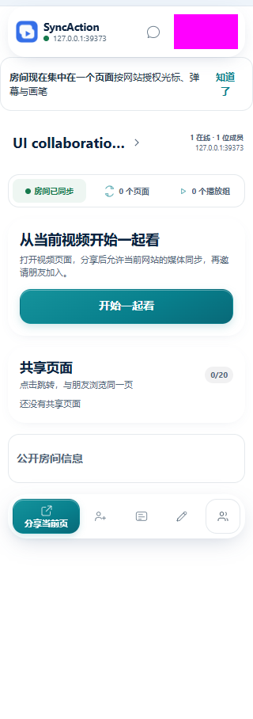
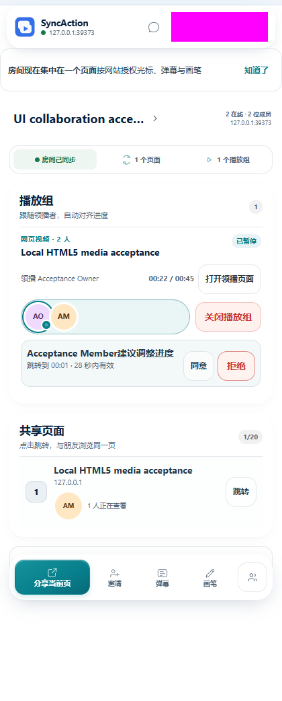

# 任务与对象导向 UI：首批验收

日期：2026-10-23（Asia/Hong_Kong）。本批为 v0.9.11 之后的本地界面候选，尚未发行或部署。设计规则见
[以任务和对象组织侧栏](../design/task-oriented-ui.md)。

## 范围

仅调整房间界面的动作承诺、状态范围和首步指引：

- “打开领播页面”明确只打开页面。
- “房间已同步”与媒体授权 / 跟随分开表达；在线人数保留在房间身份区域，摘要栏为三项。
- 空共享页保留标题、数量与简短状态，以“开始一起看”为突出的首次观看入口；独立分享继续可用。

没有修改同步协议、媒体控制器、网站同意、原目标续接、服务器或生产数据。没有新增玻璃效果或动画；保留现有材质与可访问性适配。

## 结果

真实 Chromium 147，独立本地 PostgreSQL / 公共服务 / 管理员服务 / 媒体站点，两个独立配置。运行编号
`mvjwe0l8`。

| 检查           | 结果                                                                                                   |
| -------------- | ------------------------------------------------------------------------------------------------------ |
| 空房间开始路径 | 唯一“开始一起看”主指引；共享页标题、0 计数和独立分享保留；旧的底部分享指导和大图移除                   |
| 打开领播页面   | 收到 `MEDIA_MEMBER_JUMP` 成功回复；仍无媒体成员身份；没有自动 JOIN / ALIGN，随后显式加入才跟随         |
| 双人媒体       | 8 次连续播放采样推进；暂停后双方 1.768 秒；跳到 22.5 秒后至少保持 600ms，双方均 22.5 秒                |
| 操作结果       | 关闭播放组真实成功回复；弹幕命令成功、真实输入框出现、Escape 关闭；未发送弹幕内容                      |
| 320 / 420px    | 文档宽度等于视口；摘要三列，三个标签实际 scrollWidth 均不大于 clientWidth，无标签截断                  |
| 减少动态效果   | 最大动画与过渡时长均 0 秒                                                                              |
| 定向测试       | 相关 UI / 侧栏 / 可访问性 4 文件、54 项通过；扩展类型、相关 ESLint、格式与 diff 检查通过；独立审查通过 |

10 秒前台扩展源应用标签页采样 TaskDuration 为 0.011211 秒，LayoutCount 为 0，RecalcStyleCount 为 21，JS
heap 10,036,672 →
10,036,864 字节。这是一次局部样本，不与此前样本作因果比较，不代表长时、全部页面、原生侧栏或设备容量。

本地构建的实际入口来自 `sidepanel.html`：

- `sidepanel-CzplJXDm.js`
  SHA-256：`88f28f7ea05edfd17ff886e0f96f0996d068fa2147053820008b7a0d9d70534e`。
- `sidepanel-DLzGLXY6.css`
  SHA-256：`ab5586e9d6d7f100215a3388bf318477924685bc51af643ab506360afccec07e`。

## 范围边界

使用公开源码的本地配置构建，媒体分段副本仅预授予本地测试站点权限，仍经过产品同意、真实命令、Socket 与媒体执行；不声明其与正式发行 ZIP 字节相同。浏览器原生授权点击与原生 Side
Panel 容器仍需手动覆盖。原独立数据库仅恢复运行，没有重新 seed 或切换到生产。

最终截图在入场动画结束后获取；截图工具禁用有限动画以固定静态画面，不代表产品默认关闭动画。减少动态效果另以实际媒体偏好和计算样式验证。新证据不覆盖已发行 v0.9.11 的验收截图。

这批验证说明三处具体调整可用，不能证明全部界面成熟度、真人理解或效率提升；后续仍按设计规则逐批调整观看工作面、授权与连接层级。

## 真实画面

空房间补拍运行
`mvjwflff`，使用同一构建与原隔离环境，只补取稳定的空态截图。账号区域遮挡；使用本地合成测试数据。

