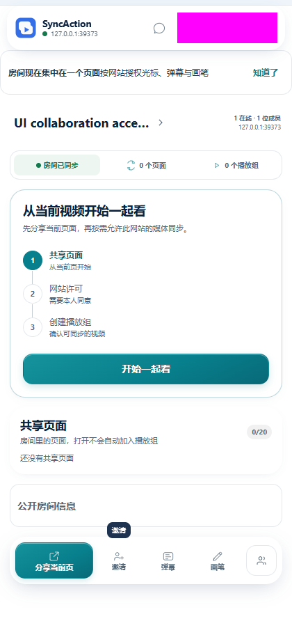
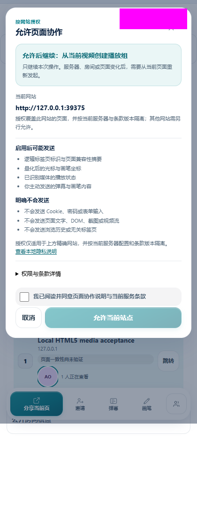
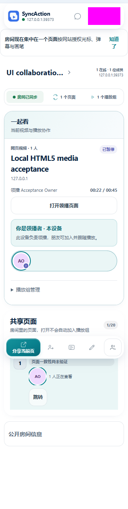
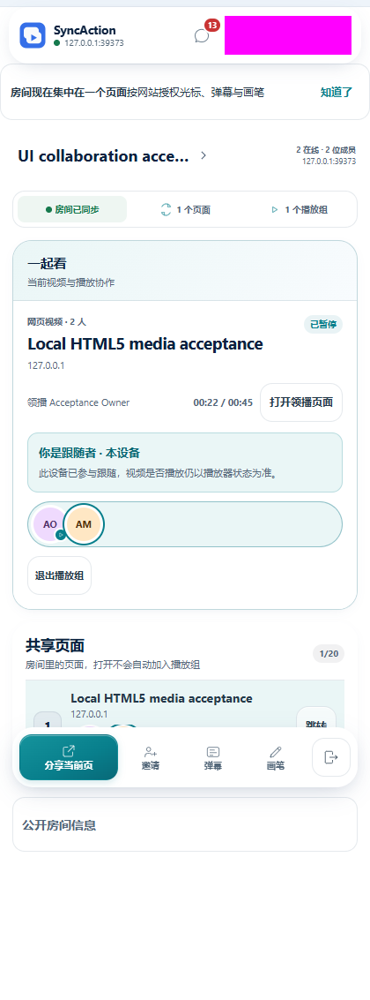
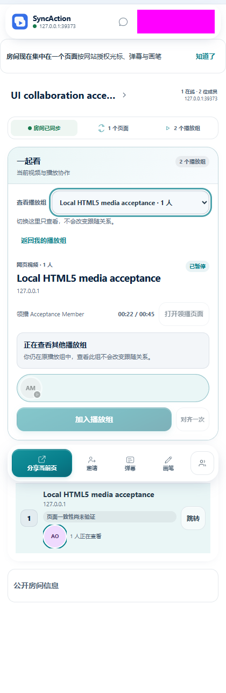
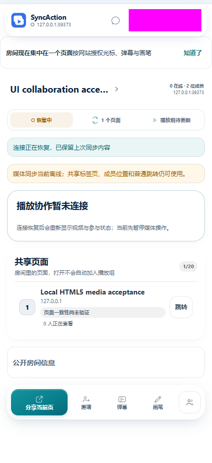
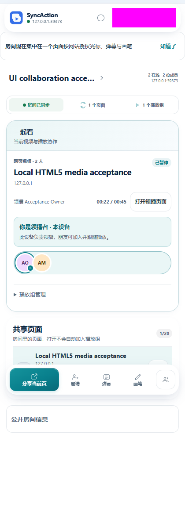

# 观看工作面、授权与连接验收

日期：2026-10-23，目标版本 v0.9.12。设计约束见[任务与对象工作面](../design/task-oriented-ui.md)。

## 实际变化

观看区域从多个同权卡片改为一个主要工作面。标题、领播者、媒体进度、本人的设备参与状态和下一步动作在同一区域；其他组通过原生选择框查看，不发出加入或对齐命令。默认查看本人组，否则选择推荐或首个可用组，随后保留实际选择。推荐与排序更新不重挂当前卡片；成员关系改变会重新定位，远程删除所选组会选取可用组，只有原焦点确实消失时才提供键盘落点。

未参与播放组时可通过次级展开区，用当前视频另建播放组。它复用首次观看的分享、网站许可、媒体识别和创建流程。关闭播放组进入就近管理区；领播者查看其他组时，本人组的提议仍可处理。

授权窗明确本次允许后继续创建、加入或页面工具操作；网站范围、数据说明和同意保持首层，技术权限和条款版本按需展开。同一帧防重复、取消、已保存许可但启用失败后的重试、上下文过期和卸载后的迟到结果都有回归。健康服务信息收为可展开的一行；异常原因和恢复动作始终可见，检测服务与重新连接服务器分别执行真实操作。

动画限于播放组内容切换和状态色彩连续变化。心跳保留节点与焦点，不反复入场；观看内容不增加背景采样。新增样式按观看、连接与授权拆分。

断线或首个媒体快照尚未到达时，显示恢复工作面和“播放组待更新”，暂停建组入口，等待真实状态恢复；快照版本 0 是有效空组结果。

## 源码与数据验证

| 检查                 | 结果                                                                                                               |
| -------------------- | ------------------------------------------------------------------------------------------------------------------ |
| 完整 `pnpm test`     | 1,527 通过：tooling 26，workspace 1,501，其中扩展 968                                                              |
| 全仓类型检查、ESLint | 通过                                                                                                               |
| 独立 PostgreSQL 集成 | 28 文件、274 项通过；与浏览器环境使用不同数据库                                                                    |
| 密集 UI 更新         | 20 个页面、20 位成员、5 个播放组、60 条通知；30 次媒体与通知更新，p95 小于原有 100 ms 门槛，稳定页面与主组节点保留 |
| 独立审查             | 授权与连接、观看与焦点修复、样式与玻璃优化通过；发现的自动切组问题已修复并回归                                     |

初次全量测试发现旧性能断言假定同时挂载五个播放组；已改为一个主组和五个可选对象，并增加真实媒体更新。没有放宽性能门槛。该测试使用 Happy
DOM，不代表真实浏览器或真人计时。

玻璃折射图跳过中性内容区域的距离与法线计算。对原实现比较 864 组尺寸/圆角组合及 7 个代表尺寸，像素完全相同；三个代表尺寸的 SHA-256 已纳入自动回归。一次本机 Node
v24.15.0 采样中，420 × 800、圆角 22 的生成函数中位耗时由 5.31 ms 变为 2.07
ms（预热各 50 次，15 组、每组 10 次）。这是生成函数的局部数据，不代表整体性能提升比例。

## 真实浏览器范围

使用独立 Chromium
147 配置、实际扩展后台、公共/管理服务、PostgreSQL、Socket.IO 和可解码的本地 MP4。没有使用用户浏览器资料或生产业务数据。Browser 技能的运行文件在本机缺失，因此使用已安装的 Playwright 验收工具。

浏览器结果按实际构建和运行分开保留：

| 运行                          | 已确认结果                                                                                                                                                                                                                                     |
| ----------------------------- | ---------------------------------------------------------------------------------------------------------------------------------------------------------------------------------------------------------------------------------------------- |
| `mvjxxe03`，UI `DUDilxwG`     | 真实创建/加入授权目的、取消与新同意重试、本地隐私页；双端持续播放/暂停/22.5秒 seek；第二组通过UI创建，键盘切组0命令、原成员关系与焦点保持；真实TCP断线显示等待且隐藏建组，恢复同原组/领播状态。此轮原Close焦点失败，未标为整轮通过。           |
| `mvjy5c9u`，最终UI `CDWWrWyF` | Close忙态保留焦点；只延迟约300ms真实返回字节，两次原生Enter仅1条Close；放行未修改的ACK/事件后焦点回Start。另验证用户转向外部控件时不抢焦点、真实媒体播放/暂停/seek sanity、弹幕输入与Escape。最终源码相对上一行只增加Close忙态守卫和对应样式。 |
| `mvjxswdd`，UI `BMYwD0WX`     | 注册PENDING、管理员密码/TOTP、只批准本次随机账号、批准后登录。此鉴权路径在后续观看门禁与Close修复中未改变。                                                                                                                                    |

最终包在320 / 420px无横向溢出，摘要标签完整；原生Chrome tabs API
2倍缩放通过。减少动画时最大动画及过渡时长均为0。10秒前台扩展应用页采样 TaskDuration
0.006014秒、LayoutCount
1；它不代表原生侧栏或容量基准。验收浏览器已关闭，专属代理端口无监听，本地服务保留。

最终实际引用的UI JS SHA-256为
`c8e4cea4bc8951a65db0ae90f0ad49cb5933a9003308585bd7cf0838c01b35c3`，CSS为
`c78b512ad4c1c57520dbf28edbda95041d3ed0e303bd61a1ee591e7c92a21fd4`；引用从sidepanel.html读取。断线恢复验证的是同原组与领播状态，恢复后的持续播放未单独计时。更早的浏览器离线开关实验因观察目标生命周期变化而不确定，不计为通过。

验收使用扩展应用页承载真实 UI，未覆盖原生 Side
Panel 容器。原生服务器/网站权限提示无法由本机工具点击：未授权请求和预先允许测试网站后的产品同意流程分段验证；预授权副本只加入本地媒体 fixture 的 host 权限，不替换同意、业务命令、服务响应或媒体结果。测试副本不声明与正式发行 ZIP 字节相同。

## 截图

截图账户身份已遮盖；截图时关闭有限入场动画，减少动画偏好另行验证。320px图来自最终定点构建，其余来自上述主流程，静态布局相同。

